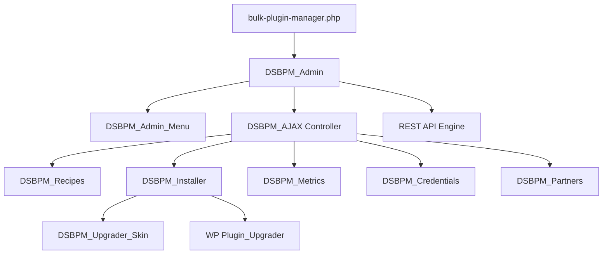
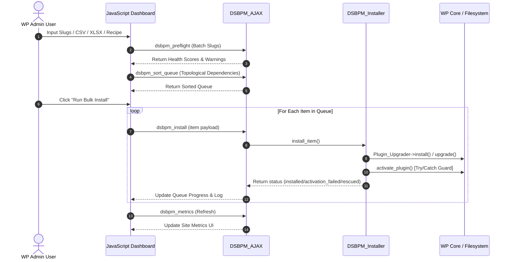

# Architecture & System Design — DazeStack Bulk Plugin Manager (v0.0.2)

This document provides exhaustive technical documentation of the architecture, module breakdown, data flows, security controls, and design system of the **DazeStack Bulk Plugin Manager (DSBPM)**.

---

## 🏛️ System Architecture Overview

DSBPM follows a decoupled, event-driven WordPress plugin architecture. The backend comprises specialized PHP singletons handling distinct business concerns, while the frontend is a reactive vanilla JavaScript dashboard with glassmorphic CSS tokens.

---

## 🧩 Core Class Modules & Responsibilities

### 1. Plugin Entry Point (`bulk-plugin-manager.php`)
- Bootstraps the application on `plugins_loaded`.
- Defines environment constants (`DSBPM_VERSION = '0.0.2'`, `DSBPM_DIR`, `DSBPM_URL`, `DSBPM_SLUG`, `DSBPM_PARTNER_OFFERS_URL`).
- Loads all class dependencies cleanly in order.

### 2. Admin Controller (`includes/class-dsbpm-admin.php`)
- Enqueues dashboard assets (`admin.css`, `admin.js`, vendor `read-excel-file.min.js`).
- Passes localized script data (`DSBPM_DATA`) including AJAX URLs, nonces, REST endpoints, and system versions.
- Registers 24+ secure `wp_ajax_` actions with capability and nonce checks.
- Registers REST endpoints (`GET /wp-json/dazestack/v1/health`, `GET /wp-json/dazestack/v1/abilities`).
- Hooks into Action Scheduler (`dsbpm_run_install`) for async background provisioning.

### 3. Admin Menu & Views (`includes/class-dsbpm-admin-menu.php`)
- Registers top-level `DazeStack` admin menu and 4 subpages:
  1. **Dashboard** (`dazestack-suite`): Overview of DazeStack series & ecosystem.
  2. **Bulk Plugin Manager** (`bulk-plugin-manager`): Primary provisioner, queue, and stack workspace.
  3. **About & Legal** (`dsbpm-about-legal`): External service disclosures, privacy policies, and GPLv2+ license documentation.
  4. **Review & Rate Us** (`dsbpm-review`): 5-star rating callout page with direct WP.org links.
- Handles stack CSV export (`admin_post_dsbpm_export`).

### 4. AJAX Controller (`includes/class-dsbpm-ajax.php`)
- Sanitizes and validates all incoming user requests.
- **Full-Queue Batching**: Evaluates pre-flight health checks and download payload estimations without hardcoded item caps.
- **SSRF Defense**: Validates remote URL host IPs via `gethostbyname()` to block loopback (`127.0.0.1`) and private IP ranges (`10.0.0.0/8`, `172.16.0.0/12`, `192.168.0.0/16`, `169.254.169.254`). Enforces a 5MB response body limit.
- Manages topological sorting, recipe persistence, WP-CLI script generation, and auto-update toggles.

### 5. Recipes & Playbooks Engine (`includes/class-dsbpm-recipes.php`)
- Manages built-in curated stack recipes (*WooCommerce Starter*, *Performance Suite*, *Security Suite*, *SEO Suite*).
- Manages user-saved custom recipes stored in WordPress options (`dsbpm_recipes`).
- **WP-CLI Generator**: Converts queue items into executable terminal commands (`wp plugin install <slugs> --activate`).

### 6. Installer & Rollback Guard (`includes/class-dsbpm-installer.php`)
- Wraps `Plugin_Upgrader` with **[DSBPM_Upgrader_Skin](file:///Users/anumac/Documents/%20Projects/bulk-plugin-manager/includes/class-dsbpm-skin.php)** to capture upgrader feedback silently into memory.
- **Automated Rollback Guard**: Wraps `activate_plugin()` inside `try...catch (\Throwable $e)` blocks. On fatal errors, activation is rolled back (`deactivate_plugins`), and detailed diagnostic traces are logged cleanly in the UI.

### 7. Credentials Security (`includes/class-dsbpm-credentials.php`)
- Provides encrypted storage for FTP/SSH credentials when `wp-content/plugins` is non-writable.
- Uses `AES-256-CBC` encryption via OpenSSL keyed with `wp_salt('auth')`.

### 8. Metrics & Security Engine (`includes/class-dsbpm-metrics.php`)
- Calculates disk usage, average plugin size, largest plugin, active/inactive counts, and auto-update status.
- Integrates with WPScan API (`/api/v3/plugins/`) to block critical vulnerabilities (CVSS >= 9.0).

### 9. Partners Feed Engine (`includes/class-dsbpm-partners.php`)
- Fetches, parses, and normalizes remote partner offers CSV with 12-hour transient caching and local backup fallbacks.

---

## 🔄 Data Flows & Workflows

### Bulk Installation Workflow

---

## 🎨 Design System & Visual Tokens

- **Fonts**: `Fraunces` (Header Serif) + `Plus Jakarta Sans` (Body Sans) + `IBM Plex Mono` (Code)
- **Canvas Mesh Gradient**: Multi-point radial mesh (`#6ee7b7` + `#fbbf24` + `#f8b4c4` on `#f7fbff`)
- **Primary CTA Accent**: Warm Tangerine Gradient (`#ffb58a` to `#ff8a65`)
- **Active State Accent**: Deep Emerald Teal (`#1f9d8a`)
- **Glassmorphism**: Translucent frosted cards (`rgba(255, 255, 255, 0.92)` with `backdrop-filter: blur(12px)`)

---

## 🔒 Security Architecture

1. **Authentication & Authorization**: `current_user_can('install_plugins')`, `activate_plugins`, `delete_plugins` checked on every handler.
2. **CSRF Protection**: Cryptographic nonces (`dsbpm_nonce`) verified on every request.
3. **SSRF Mitigation**: Host IP verification blocks private/loopback addresses; 5MB response cap prevents memory amplification.
4. **Credential Encryption**: `AES-256-CBC` keyed with WP secret auth salts.
5. **No Frontend Footprint**: Zero assets or scripts loaded on public site pages.
