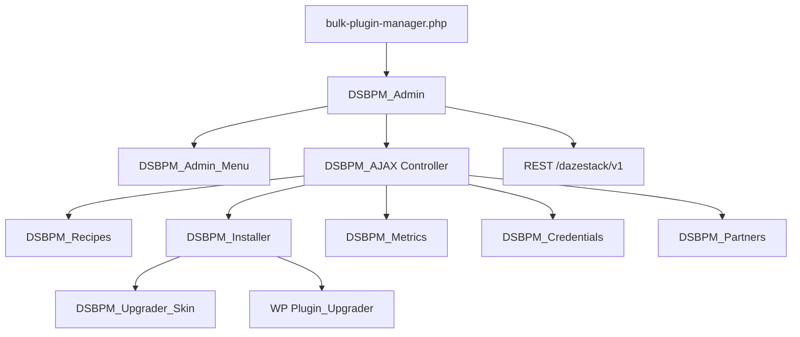

# Project Master Snapshot — DazeStack Bulk Plugin Manager (v0.0.2)

**Timestamp**: `2026-08-08T04:48:00+05:30`  
**Git Tag**: `v0.0.2`  
**SVN Revision**: `3638346`  
**Plugin Slug**: `dazestack-bulk-plugin-manager`  
**WordPress.org URL**: [dazestack-bulk-plugin-manager](https://wordpress.org/plugins/dazestack-bulk-plugin-manager/)  
**Release Zip**: [dazestack-bulk-plugin-manager.zip](file:///Users/anumac/Documents/%20Projects/bulk-plugin-manager/dazestack-bulk-plugin-manager.zip)

---

## 📸 Snapshot Overview

This snapshot records the complete state of the **DazeStack Bulk Plugin Manager (DSBPM)** project following the successful v0.0.2 release and deployment to the WordPress.org Plugin Directory.

---

## 🗂️ Complete File Manifest & Hash Verification

| File Path | Description | Version |
| :--- | :--- | :---: |
| `bulk-plugin-manager.php` | Main plugin entry point & constant bootstrap | `0.0.2` |
| `includes/class-dsbpm-admin.php` | Asset enqueuer, AJAX hook router, & REST registration | `0.0.2` |
| `includes/class-dsbpm-admin-menu.php` | Admin menus, UI templates, subpages & export handlers | `0.0.2` |
| `includes/class-dsbpm-ajax.php` | AJAX controller with 24+ secured endpoints | `0.0.2` |
| `includes/class-dsbpm-recipes.php` | Stack recipes catalog, option storage, & WP-CLI generator | `0.0.2` |
| `includes/class-dsbpm-installer.php` | Upgrader wrapper with activation rollback sandbox | `0.0.2` |
| `includes/class-dsbpm-credentials.php` | AES-256-CBC encrypted FTP/SSH credential manager | `0.0.2` |
| `includes/class-dsbpm-metrics.php` | Site disk usage, average sizing, & WPScan vulnerability scanner | `0.0.2` |
| `includes/class-dsbpm-partners.php` | Partner offer feed parser with local backup fallbacks | `0.0.2` |
| `includes/class-dsbpm-skin.php` | Silent upgrader output feedback skin | `0.0.2` |
| `assets/admin.css` | Design system styling, tokens, glassmorphism, responsive grid | `0.0.2` |
| `assets/admin.js` | Reactive dashboard logic, queue state, recipes, shortcuts | `0.0.2` |
| `assets/data/partner-offers.csv` | Local fallback partner offers feed | `0.0.2` |
| `assets/data/partner-offers.xlsx` | Local XLSX backup partner offers feed | `0.0.2` |
| `assets/vendor/read-excel-file.min.js` | Client-side XLSX file parser | `3.5.x` |
| `docs/ARCHITECTURE.md` | Exhaustive architecture, sequence diagrams & security docs | `0.0.2` |
| `docs/SNAPSHOT_v0.0.2.md` | Master project snapshot document | `0.0.2` |
| `README.md` | GitHub repository overview & usage instructions | `0.0.2` |
| `readme.txt` | WordPress.org plugin directory header, specs & changelog | `0.0.2` |
| `PROJECT_CONVENTIONS.md` | AI & Developer guidelines, standards & QA checklist | `0.0.2` |
| `deploy.sh` | Automated Subversion (SVN) deployment script | `0.0.2` |
| `dazestack-bulk-plugin-manager.zip` | Standalone release package archive | `0.0.2` |

---

## 🔒 Security Architecture Summary

1. **Authorization Controls**: `current_user_can('install_plugins')`, `activate_plugins`, `delete_plugins` enforced per action.
2. **CSRF Nonce Check**: `check_ajax_referer('dsbpm_nonce', 'nonce')` on all AJAX endpoints.
3. **SSRF Mitigation**: Host IP validation via `gethostbyname()` rejecting private (`10.0.0.0/8`, `172.16.0.0/12`, `192.168.0.0/16`) and loopback (`127.0.0.1`) ranges. Response body size capped at 5MB (`limit_response_size`).
4. **Credential Encryption**: Transients encrypted with `AES-256-CBC` via OpenSSL using secret key derived from `wp_salt('auth')`.
5. **Exception Sandbox**: `activate_plugin()` wrapped in `try...catch (\Throwable $e)` to prevent PHP fatal crashes during bulk activations.

---

## 🎨 Visual Design Tokens & Palette

- **Primary Action Gradient**: Warm Tangerine (`#ffb58a` → `#ff8a65`)
- **Accent & Active State**: Deep Emerald Teal (`#1f9d8a`)
- **Canvas Mesh Gradient**: Translucent radial mesh (`#6ee7b7` + `#fbbf24` + `#f8b4c4` over `#f7fbff`)
- **Typography**: `Fraunces` (Editorial Serif) + `Plus Jakarta Sans` (Geometric Sans) + `IBM Plex Mono` (Code)
- **Glassmorphism**: Translucent frosted cards (`rgba(255, 255, 255, 0.92)` with `backdrop-filter: blur(12px)`)

---

## 🚀 Verification & Build Artifacts

- **PHP Linting**: 100% pass across all 10 PHP files via `php -l`.
- **Git Commit**: `dc43831` on `main`.
- **Git Tag**: `v0.0.2`.
- **SVN Revision**: `3638346` live on WordPress.org SVN.
